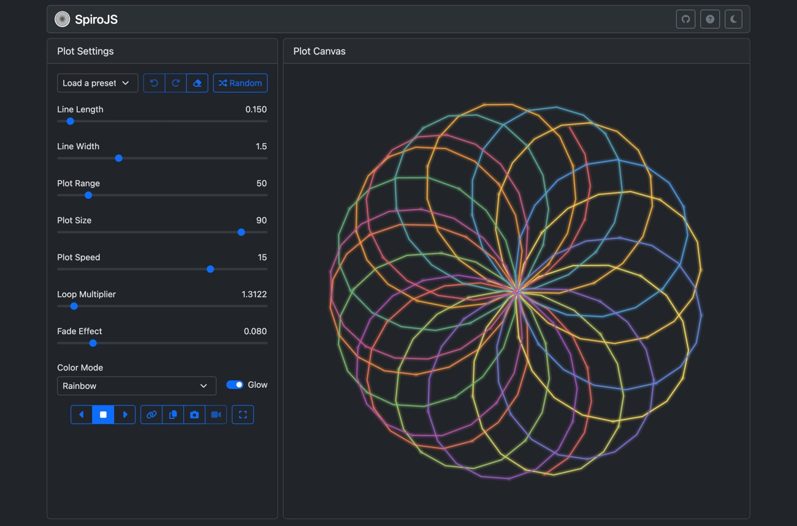

# SpiroJS - Animated Spiral Circle Graphs

SpiroJS draws animated spiral circle graphs using sine and cosine trigonometry functions. It uses JavaScript, Font Awesome, and Bootstrap 5.

This is code converted from my original 1982 Commodore 64 Basic program.



## Running it

This will run locally without the need of a web server. Just download, extract, and open the `index.html` file.

When served over `http(s)`, SpiroJS can also be installed as an app and works offline after the first visit.

## Features

- **Animated plots:** play forward or backward and watch the pattern evolve as the loop multiplier changes.
- **Presets and random settings:** start from a curated preset or shuffle the settings to discover new patterns.
- **Undo, redo and reset:** step back through changes, or return everything to the defaults.
- **Precise control:** type an exact value into any setting, or fine-tune the loop multiplier by scrolling or dragging sideways on the canvas.
- **Color modes:** Mono, Rainbow, Sunset, and Ocean gradients along the curve, with an optional glow.
- **Fading trails:** adjustable trail length for a motion-blur effect while animating.
- **Fullscreen mode:** controls fade out when the mouse is still and reappear when it moves.
- **Export:** copy the image to the clipboard, download it as a PNG, or record up to 5 minutes of video.
- **Shareable links:** copy a URL that reopens the plot with the same settings.
- **Light and dark themes:** follows your system setting by default.
- **Built-in help:** the ? button in the top bar shows or hides tooltips, help text under each field and the shortcuts list.
- **Remembers your settings** between visits.

## Controls

| Setting | What it does |
| --- | --- |
| Line Length | Step between plotted points. Small values give smooth curves; large values give angular, geometric shapes. |
| Line Width | Thickness of the lines. |
| Plot Range | How far the curve runs. Higher values draw more loops. |
| Plot Size | Size of the plot relative to the canvas. |
| Plot Speed | How fast the loop multiplier changes while animating. |
| Loop Multiplier | The main shape control. Small changes produce very different patterns. |
| Fade Effect | How quickly old lines fade while animating. Lower values leave longer trails. |
| Color Mode / Glow | Line coloring and the optional glow effect. |

Click the number next to a slider to type an exact value. Over the canvas, scroll or drag left and right to fine-tune the loop multiplier (hold <kbd>Shift</kbd> for bigger steps).

### Keyboard shortcuts

| Key | Action |
| --- | --- |
| <kbd>Space</kbd> | Play / stop |
| <kbd>F</kbd> | Toggle fullscreen |
| <kbd>C</kbd> | Next color mode |
| <kbd>G</kbd> | Toggle glow |
| <kbd>R</kbd> | Random settings |
| <kbd>H</kbd> | Toggle help (tooltips, field help and shortcuts) |
| <kbd>←</kbd> / <kbd>→</kbd> | Nudge the loop multiplier (hold <kbd>Shift</kbd> for bigger steps) |
| <kbd>Ctrl</kbd>/<kbd>⌘</kbd>+<kbd>Z</kbd> | Undo |
| <kbd>Ctrl</kbd>/<kbd>⌘</kbd>+<kbd>Shift</kbd>+<kbd>Z</kbd> or <kbd>Ctrl</kbd>+<kbd>Y</kbd> | Redo |

## URL parameters

The **Copy Settings URL** button builds a link like this, but you can also write one by hand. Any parameter can be left out.

```
index.html?Multiplier=1.3&LineLength=0.15&Saturation=50&ColorMode=rainbow&Glow=true&Theme=dark
```

| Parameter | Range |
| --- | --- |
| `Multiplier` | 0 – 20 |
| `LineLength` | 0.01 – 3 |
| `LineWidth` | 0.5 – 4 |
| `Saturation` (Plot Range) | 1 – 360 |
| `PlotSize` | 10 – 100 |
| `PlotSpeed` | 1 – 20 |
| `FadeEffect` | 0.001 – 0.5 |
| `ColorMode` | `mono`, `rainbow`, `sunset`, `ocean` |
| `Glow` | `true`, `false` |
| `Theme` | `light`, `dark` |

Settings in the URL take priority over your saved settings.

## License

[MIT](LICENSE)
